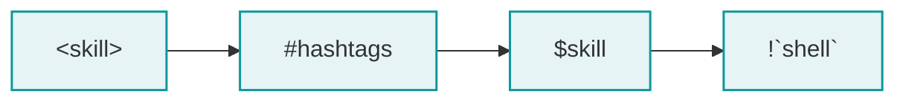

<div align="center">


# opencode-snippets

**Type a `#hashtag` anywhere in an [OpenCode](https://opencode.ai) prompt.<br>It expands into the instructions you would otherwise type again.**

<a href="https://www.npmjs.com/package/opencode-snippets"></a>
<a href="https://www.npmjs.com/package/opencode-snippets"></a>
<a href="https://github.com/JosXa/opencode-snippets/stargazers"></a>

<a href="https://github.com/JosXa/opencode-snippets/blob/main/LICENSE"></a>

[**Install**](#-install)&nbsp;&nbsp;&nbsp;[Quick start](#-quick-start)&nbsp;&nbsp;&nbsp;[Features](#-features)&nbsp;&nbsp;&nbsp;[Library](#-snippet-library)&nbsp;&nbsp;&nbsp;[Configuration](#-configuration)&nbsp;&nbsp;&nbsp;[Share snippets](https://github.com/JosXa/opencode-snippets/discussions/categories/snippets)

<br>



</div>

<br>

> [!TIP]
> **Got a snippet that saves you time?** Share it, or borrow ideas from others, in [GitHub Discussions](https://github.com/JosXa/opencode-snippets/discussions/categories/snippets).

##  Why snippets?

A snippet is a Markdown file with an instruction you use often. Write it once, then add it to any message with its `#name` instead of pasting or typing it again.

<table>
<tr>
<td width="25%" valign="top"><b>🔄 Write once</b><br>Keep an instruction in one file and use it in every session.</td>
<td width="25%" valign="top"><b>🧩 Compose</b><br>Build large prompts from small pieces. Snippets can include other snippets.</td>
<td width="25%" valign="top"><b>🔧 Update once</b><br>Edit the file and the next message uses the new text everywhere.</td>
<td width="25%" valign="top"><b>🔍 Discover</b><br>Type <code>#</code> to list every snippet and pick one with autocomplete.</td>
</tr>
</table>

OpenCode's `/slash` commands must come first in a message. Snippets work anywhere, like `@file` mentions:

```text
/git-status Review my changes                   ← command: first word only
Review my changes #git-status, then #code-style   ← snippets: anywhere
```

| | `/commands` | `#snippets` |
|---|---|---|
| Position | First word only | Anywhere |
| Several per message | No | Yes |
| Live shell data | Yes | Yes |
| Best for | Triggering actions and workflows | Context engineering |

<details>
<summary><b>Can't decide?</b> Make a command that forwards to a snippet.</summary>

<br>

Use slash commands for actions that must happen *now* (`/commit-and-push`, `/add-worktree`, `/pull-rebase`) and snippets for everything else. A command can also forward to a snippet of the same name:

```markdown
---
description: Forward to the snippet at snippet/pull.md
---
#pull
```

</details>

##  Install

Add `opencode-snippets` to `plugins` in `opencode.json`. OpenCode loads the terminal parts as well: autocomplete, field forms and the snippet library.

```json
{
  "plugins": ["opencode-snippets"]
}
```

<details>
<summary>Local development build</summary>

<br>

Run `bun install` and `bun run build`, then add the built `dist` directory to `plugins` in both `opencode.json` and `cli.json`:

```json
{
  "plugins": ["file:///absolute/path/to/opencode-snippets/dist"]
}
```

Rebuild after every source change to test the updated server and terminal entry points.

</details>

##  Quick start

1. Run `/snippets`, choose **New**, name it `careful` and select **Global**.
2. Enter this source and press <kbd>Ctrl</kbd>+<kbd>S</kbd>:

   ```markdown
   ---
   aliases: safe
   ---
   Think step by step. Double-check your work before committing changes.
   Ask clarifying questions if anything is ambiguous.
   ```

3. Type `#careful`, or its alias `#safe`, anywhere in a message.

https://github.com/user-attachments/assets/ebb303b5-d41b-4d87-8f08-eb1d730db5c8

##  Compose snippets

Snippets work in messages, in slash commands and inside other snippets. Small files combine into layered prompts: `#tdd #careful` for careful test-driven work, `/commit #conventional-commits #project-context` for context-aware commits.

<table>
<tr>
<th width="50%">A command that uses snippets</th>
<th width="50%">Snippets that use snippets</th>
</tr>
<tr>
<td valign="top">

`command/commit-and-push.md`

```markdown
---
description: Commit and push
---
Create a git commit with the current
changes and push it.
#use-conventional-commits

Status: !`git status`
Staged: !`git diff --cached`

#project-context
```

</td>
<td valign="top">

`snippet/code-standards.md`

```markdown
#style-guide
#error-handling
#testing-requirements
```

`snippet/full-review.md`

```markdown
#code-standards
#security-checklist
#performance-tips
```

Type `#full-review` to add every standard at once. Each concern keeps its own file.

</td>
</tr>
</table>

https://github.com/user-attachments/assets/76975a9e-e326-431e-8be5-39a9f6572851

##  Features

<table>
<tr>
<td width="25%" valign="top"><b>🏷️ <a href="#aliases">Aliases</a></b><br><code>#cp</code>, <code>#pick</code> and <code>#cherry-pick</code> for one file.</td>
<td width="25%" valign="top"><b>📝 <a href="#fields-and-forms">Fields and forms</a></b><br>Typed inputs, a form in the terminal and Handlebars output.</td>
<td width="25%" valign="top"><b>💻 <a href="#shell-substitution">Shell substitution</a></b><br><code>!`git status`</code> in any prompt, with an optional echo of the command.</td>
<td width="25%" valign="top"><b>🔁 <a href="#recursive-includes">Recursive includes</a></b><br>Snippets include snippets, with loop protection.</td>
</tr>
<tr>
<td valign="top"><b>📎 <a href="#prepend-and-append-blocks">Prepend and append</a></b><br>Long reference text goes to the start or end of the message.</td>
<td valign="top"><b>💉 <a href="#inject-blocks">Inject blocks</a></b><br>Context that the model receives for the whole turn, outside your message.</td>
<td valign="top"><b>🧠 <a href="#skills">Skills</a></b><br><code>$review</code> loads an OpenCode skill. <code>&lt;skill&gt;</code> inlines one.</td>
<td valign="top"><b>📚 <a href="#-snippet-library">Library</a></b><br>A Vim-style browser and editor for all snippets.</td>
</tr>
</table>

### Aliases

```markdown
---
aliases:
  - cp
  - pick
description: "Git cherry-pick helper"
---
Always pick parent 1 for merge commits.
```

`#cherry-pick`, `#cp` and `#pick` now expand to the same text. One alias needs no list (`aliases: safe`), and JSON style works too (`aliases: ["cp", "pick"]`).

### Fields and forms

Declare typed inputs in YAML frontmatter and use the answers as Handlebars variables:

```markdown
---
fields:
  count:
    label: Options
    type: number
    default: 5
    min: 0
    integer: true
---
{{#if (gt count 0)}}Offer {{count}} {{plural count "option" "options"}}.{{/if}}
```

Accept a completion, or type a space after a snippet name, to fill its form. Autocomplete marks these snippets with `☷`. Confirming writes a readable reference such as `#options(count=3)` into the composer, and sending the message expands it. <kbd>Ctrl</kbd>+<kbd>G</kbd> edits the fields of the reference under the cursor.

<details>
<summary>Field types, keys, arguments and presets</summary>

<br>

- **Types:** text, multiline text, number, checkbox, select and `multiselect`. Select options are YAML lists such as `options: [quick, normal, thorough]`.
- **Form keys:** <kbd>Tab</kbd>/<kbd>Shift</kbd>+<kbd>Tab</kbd> move between fields and buttons, arrows select, <kbd>Space</kbd> toggles, <kbd>Ctrl</kbd>+<kbd>J</kbd> inserts a newline, <kbd>Enter</kbd> confirms and <kbd>Esc</kbd> cancels. **Help** shows all keys.
- **Multiselect:** `default` is a list of selected strings. `required: true` needs at least one choice. `{{checks}}` prints the choices separated by commas, and `{{#each checks}}- {{this}}{{/each}}` prints one per line. See the [audit-tests example](https://github.com/JosXa/opencode-snippets/blob/main/examples/forms/audit-tests.md).
- **Arguments:** named keys with JSON-quoted text, numbers, `yes`/`no` and lists of strings, for example `#audit-tests(checks=["No meaningful assertions"])`. `checks=[]` clears a selection. Answers stay literal, even when they contain hashtags, shell commands or template syntax.
- **Presets:** put `#options(count=10)` in `ten-options.md`. An outer answer such as `#ten-options(count=2)` overrides it. Nested snippets share their parent's answers.
- **Opt-in:** the `fields` mapping turns Handlebars on and sets the order of inputs. Use `fields: {}` for a template without inputs. Snippets without `fields` keep `{{ }}` as literal text.
- **Headless runs** use defaults and reject missing required answers before any effect runs.

The [fields and forms reference](https://github.com/JosXa/opencode-snippets/blob/main/skill/snippets/references/fields-and-forms.md) covers constraints, escaping and conditional prose. The [example templates](https://github.com/JosXa/opencode-snippets/tree/main/examples/forms) include review, reword and options presets.

</details>

### Shell substitution

Shell substitution works in snippet files and in every message you type in OpenCode.

| You write | The model receives |
|---|---|
| ``Branch: !`git branch --show-current` `` | `Branch: main` |
| ``!>`ls` `` | `$ ls`<br>`--> README.md src …` |

The `!>` form adds the command line above its output, so the model can tell which command produced the text. A failed command keeps its original syntax in the message.

### Recursive includes

A snippet can reference other snippets with `#name`. Expansion repeats up to 15 times per message, which supports deep nesting. A circular reference (`#a` includes `#b`, which includes `#a`) stops after 15 rounds, leaves the last hashtag as text and logs a warning.

### Prepend and append blocks

Reference material that would interrupt your sentence goes into `<append>` (end of the message) or `<prepend>` (start of the message):

<table>
<tr><th width="50%"><code>snippet/jira.md</code></th><th width="50%">Input and expanded message</th></tr>
<tr>
<td valign="top">

```markdown
---
aliases: jira-mcp
---
Jira MCP server
<append>
## Jira MCP usage
- field_16570 => Acceptance Criteria
- field_11401 => Team
</append>
```

</td>
<td valign="top">

```text
Create a bug ticket in #jira-mcp
about the memory leak
```

```text
Create a bug ticket in Jira MCP server
about the memory leak

## Jira MCP usage
- field_16570 => Acceptance Criteria
- field_11401 => Team
```

</td>
</tr>
</table>

<details>
<summary>Block rules</summary>

<br>

- Text outside the blocks replaces the hashtag. A snippet with only blocks removes the hashtag.
- Several blocks of one type join in order of appearance, including blocks from nested snippets.
- An unclosed tag turns the rest of the snippet into the block.
- Nested blocks are not allowed. The hashtag stays unchanged.

</details>

### Inject blocks

> [!NOTE]
> Experimental. Set `"experimental": { "injectBlocks": true }` in the [configuration](#-configuration).

`<inject>` sends context to the model for the whole agent turn, without showing it in your message:

```markdown
---
aliases: safe
---
Think step by step.
<inject>
IMPORTANT: Check all code for security vulnerabilities.
Always suggest tests for any implementation.
</inject>
```

`Review this code #safe` shows `Review this code Think step by step.` in the transcript. The model also receives the inject content as a separate message, placed 5 messages from the bottom (`injectRecencyMessages`) so that it does not read as your latest instruction. The [injection placement notes](https://github.com/JosXa/opencode-snippets/blob/main/docs/injection-placement.md) explain why.

### Skills

> [!NOTE]
> Experimental. Enable `skillLoading` and `skillRendering` under `experimental` in the [configuration](#-configuration).

| Syntax | Effect |
|---|---|
| `$review` | Loads the skill. The transcript shows `↳ Loaded review`, and the model receives the skill content after your message. |
| `#skill("Release Notes")` | The same, for display names and IDs outside the `$` grammar. |
| `<skill>jira</skill>` or `<skill name="jira" />` | Inlines the skill body, without its frontmatter, into the message. |
| `{{skill "review"}}` | Inlines a skill inside a snippet template. |

Autocomplete uses OpenCode's own skill registry: `$` lists skills, `#` lists snippets and skills.

Expansion runs in this order:



<details>
<summary>When does <code>$</code> stay literal?</summary>

<br>

`$id` uses lowercase letters, digits, `-` and `_`, needs at least one letter and can carry `:` namespaces such as `$host:proof`. These stay literal: `$HOME`, prices, `foo$review`, `$review.path`, anything inside code spans, code blocks, shell substitutions, regex literals and `$…$` math, field answers and attachments. Write `\$review` to keep a reference literal. In Bash, quote it: `opencode run '$review'`.

</details>

##  Snippet library

Run `/snippets` to browse, edit and test project and global snippets. In OpenCode V2, every open terminal picks up saved, added, renamed and deleted snippet files at once, including edits by agents and other editors.

| Key | Action |
|---|---|
| <kbd>Enter</kbd> | Edit the Markdown source. <kbd>Ctrl</kbd>+<kbd>S</kbd> saves. |
| <kbd>Shift</kbd>+<kbd>Enter</kbd> | Open the file in `$VISUAL` or `$EDITOR`. |
| <kbd>:</kbd> | Actions: new, reload, duplicate, rename, move, delete, copy reference, test form. |
| <kbd>/</kbd> | Filter by name, alias or description. |
| <kbd>Esc</kbd> / <kbd>q</kbd> | Step back / close. Drafts stay open for the next visit. |
| <kbd>F1</kbd> | Show every key. |

<details>
<summary>Vim navigation keys</summary>

<br>

| Keys | Navigation |
|---|---|
| <kbd>j</kbd> / <kbd>k</kbd>, arrows, <kbd>Ctrl</kbd>+<kbd>N</kbd> / <kbd>Ctrl</kbd>+<kbd>P</kbd> | Next / previous row |
| <kbd>gg</kbd> / <kbd>G</kbd>, <kbd>Home</kbd> / <kbd>End</kbd> | First / last row or preview line |
| <kbd>3j</kbd>, <kbd>5G</kbd>, <kbd>5gg</kbd> | Repeat a motion, or go to a numbered row or line |
| <kbd>H</kbd> / <kbd>M</kbd> / <kbd>L</kbd> | Top / middle / bottom visible row |
| <kbd>Ctrl</kbd>+<kbd>D</kbd> / <kbd>Ctrl</kbd>+<kbd>U</kbd> | Half page down / up |
| <kbd>Ctrl</kbd>+<kbd>F</kbd> / <kbd>Ctrl</kbd>+<kbd>B</kbd> | Full page down / up |
| <kbd>Ctrl</kbd>+<kbd>E</kbd> / <kbd>Ctrl</kbd>+<kbd>Y</kbd> | Scroll one line |
| <kbd>zt</kbd> / <kbd>zz</kbd> / <kbd>zb</kbd> | Align the selected row at the top / middle / bottom |
| <kbd>h</kbd> / <kbd>l</kbd> | Focus the list / preview |
| <kbd>Ctrl</kbd>+<kbd>W</kbd> then <kbd>w</kbd> | Switch panes |
| <kbd>/</kbd> / <kbd>?</kbd>, then <kbd>n</kbd> / <kbd>N</kbd> | Filter forward / backward, next / previous match |
| <kbd>Ctrl</kbd>+<kbd>O</kbd> / <kbd>Ctrl</kbd>+<kbd>I</kbd> | Back / forward through jumps |
| <kbd>i</kbd> | Open the source editor |

Counts and unfinished key sequences show in the footer. <kbd>Esc</kbd> cancels them.

</details>

##  Example snippets

<table>
<tr>
<td width="50%" valign="top">

`snippet/context.md`

```markdown
---
aliases: ctx
---
Project: !`basename $(pwd)`
Branch: !`git branch --show-current`
Changes: !`git diff --stat HEAD~3`
```

</td>
<td width="50%" valign="top">

`snippet/minimal.md`

```markdown
---
aliases:
  - min
  - terse
---
Be extremely concise.
No explanations unless asked.
```

</td>
</tr>
</table>

##  Where snippets live

Project snippets in `.opencode/snippet/` win over global snippets with the same name in `~/.config/opencode/snippet/`. Both scopes also read a `snippets/` directory, and `snippet/` wins over it. The global root follows `OPENCODE_CONFIG_DIR`, then `$XDG_CONFIG_HOME/opencode`, then `~/.config/opencode`. The `globalDirectory` plugin option overrides it. Symlinked project snippet directories are rejected.

<details>
<summary>What happens when a message is processed</summary>

<br>

Each new message reads the current snippet files, so saved edits apply to the next message. Replayed messages keep their original expansion.

If processing fails, the original message goes through unchanged and a warning is logged. Validation finishes before any shell command runs.

The plugin stores a small record of processing output so that rebuilt history and server restarts never repeat shell side effects. Records live in `$XDG_DATA_HOME/opencode/opencode-snippets/v2` (default `~/.local/share/opencode/opencode-snippets/v2`), with mode `0700` for directories and `0600` for files. They contain hashed IDs, status, timestamps and replay output, but no prompts or project paths. Records expire after 30 days, with at most 100 sessions per project and 1,000 messages per session. Deleting a session deletes its records.

</details>

##  Configuration

The plugin creates `~/.config/opencode/snippet/config.jsonc` on first run, or `~/.config/opencode/snippets/config.jsonc` when only the plural directory exists. A project file at `.opencode/snippet/config.jsonc` (or `.opencode/snippets/config.jsonc`) overrides it.

```jsonc
{
  "logging": {
    "debug": false // logs: $XDG_DATA_HOME/opencode/log/snippets/daily/
  },
  "experimental": {
    "injectBlocks": false,   // <inject>…</inject>
    "skillRendering": false, // <skill>name</skill>
    "skillLoading": false    // $id and #skill(name)
  },
  "injectRecencyMessages": 5 // distance of injected context from the bottom
}
```

For editor completion, set `"$schema"` to the [config schema](https://raw.githubusercontent.com/JosXa/opencode-snippets/v3.5.0/schema/config.schema.json).

Boolean settings also accept `"enabled"` and `"disabled"`.

##  Behavior notes

- Snippets expand in chat messages, question answers, skills and slash commands. Assistant messages are never processed.
- Hashtags are case-insensitive (`#Hello` = `#hello`). Unknown hashtags stay unchanged.
- Frontmatter is removed from expanded text.
- Logs go to `$XDG_DATA_HOME/opencode/log/snippets/daily/`. Info, warnings and errors are always written, and `logging.debug` adds debug lines.

##  Contributing

Issues and pull requests are welcome. Questions go to the [Discord forum](https://discord.com/channels/1391832426048651334/1463378026833379409).

```sh
bun test          # unit and renderer tests
bun run test:v2   # the built plugin in real OpenCode 2 processes
```

<details>
<summary>About the OpenCode 2 runtime tests</summary>

<br>

Install the CLI version that matches `@opencode/plugin` in `package.json`, or point `OPENCODE_BIN` at a specific executable. The suite uses isolated home, config and data directories and a local deterministic model endpoint. It checks saved messages and real model requests across CLI submissions, attachments, skill tool calls, queued input, commands, restarts, forks and project boundaries. A failed test keeps its temporary directory and prints the path.

</details>

##  License

[MIT](https://github.com/JosXa/opencode-snippets/blob/main/LICENSE) © JosXa
